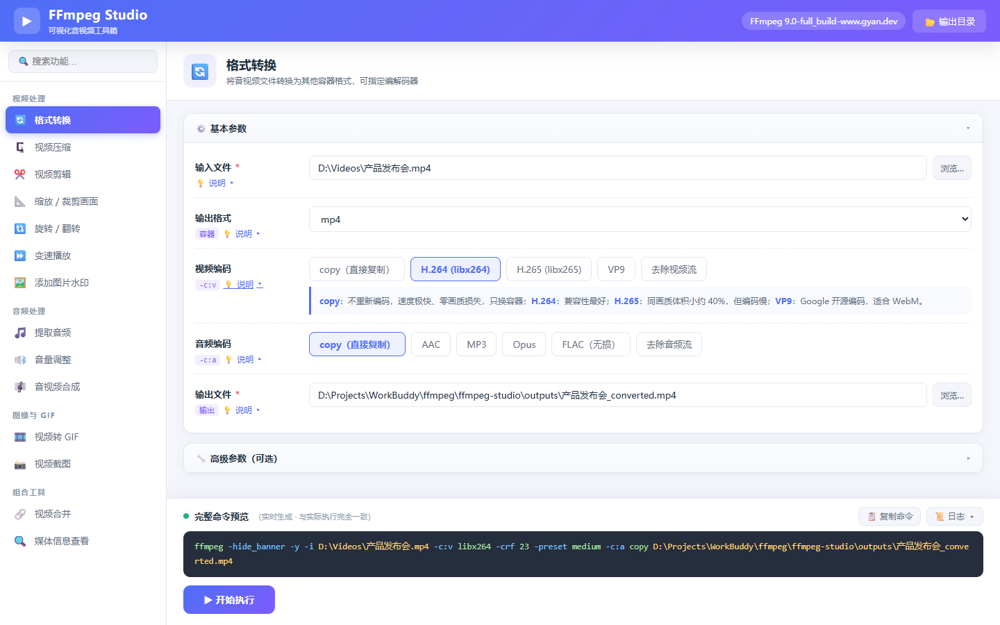
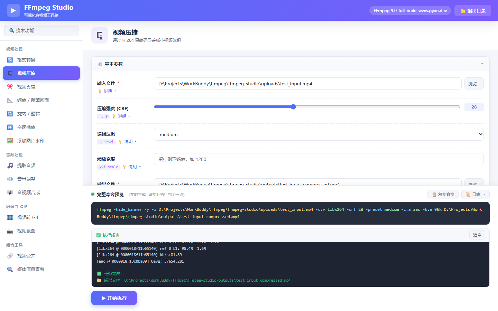
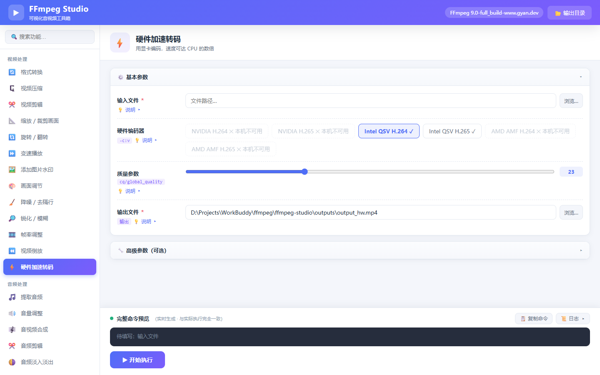
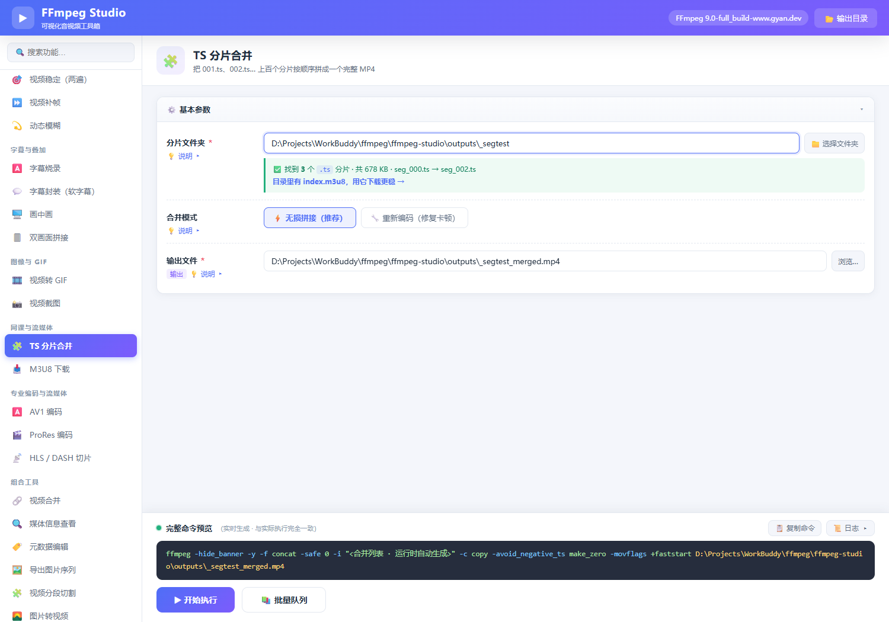
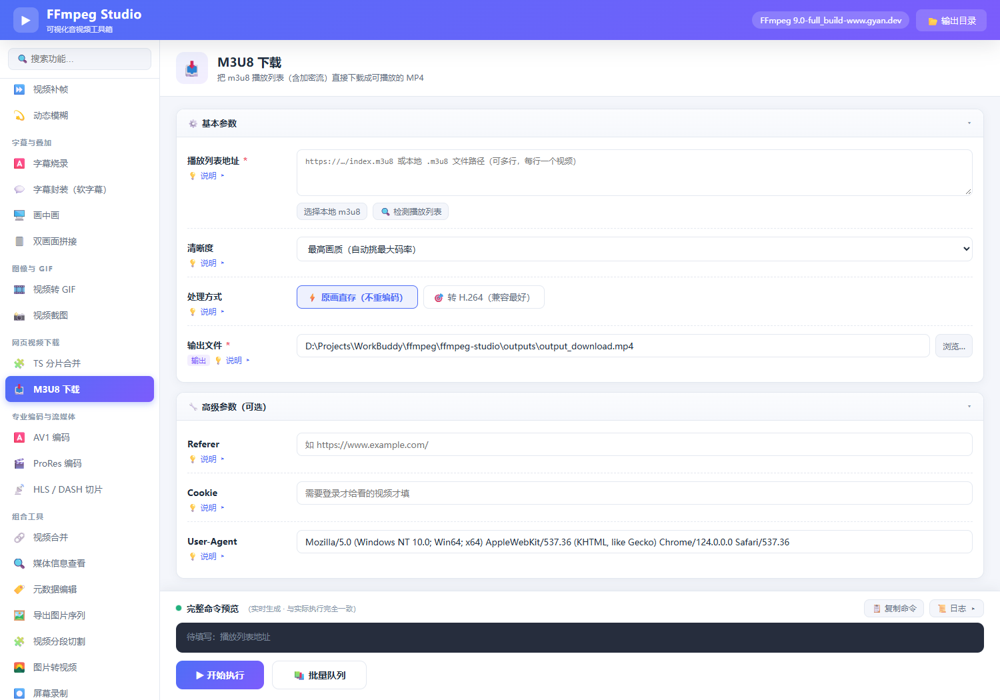
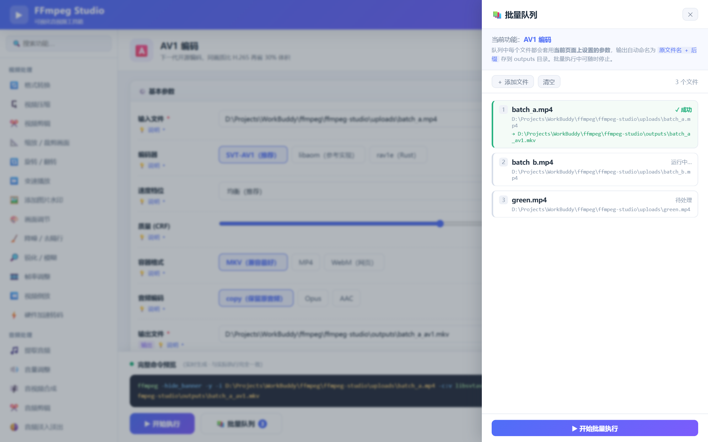
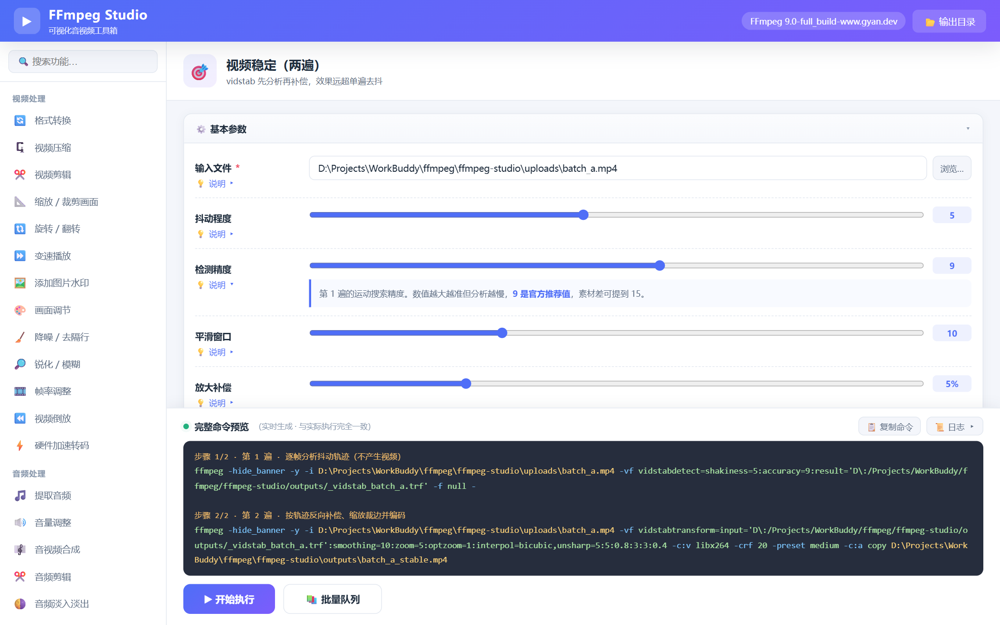

# FFmpeg Studio

> 把 FFmpeg 的命令行能力，变成点几下就能用的可视化工具。

[](https://www.python.org/)
[](https://flask.palletsprojects.com/)
[](https://ffmpeg.org/)
[](LICENSE)
[](#)

FFmpeg 是音视频处理领域的瑞士军刀，但它的学习曲线劝退了绝大多数人——几十个滤镜、上百个参数、还要记住 `-ss` 到底该放在 `-i` 前面还是后面。

**FFmpeg Studio** 把这些能力包成了本地网页界面：选功能、填参数、点执行。**它对 FFmpeg 的原始功能没有任何修改或阉割**，每一条命令都完整展示、可复制，参数旁附中文说明，随时可以展开看它到底在做什么。



---

## ✨ 特性

| | 说明 |
|---|---|
| 🖱️ **纯点击操作** | 45 个功能全部可视化，不需要记任何命令 |
| 📥 **网页视频落地** | 网站下载的一堆 ts 分片能一键合并，手里的 m3u8 链接能直接下成 MP4 |
| 📚 **批量队列** | 一次加多个文件，按当前参数逐个处理、自动命名输出，失败自动跳过 |
| ⌨️ **完整命令可见** | 底部实时生成整条 ffmpeg 命令，语法高亮、一键复制，**所见即所跑** |
| 🔁 **多遍处理可见** | 视频稳定这类两遍算法会分步展示命令与执行进度，不藏黑盒 |
| 💡 **参数自带解释** | 每个参数都有「💡 说明」，默认收起，点开即看作用、取值范围和取舍 |
| 📊 **实时日志** | SSE 流式回传 ffmpeg 输出，进度、错误一目了然；停止时让 FFmpeg 正常收尾，不毁文件 |
| 📂 **原生文件对话框** | 「浏览…」直接弹 Windows 系统选择框，支持多选 |
| 🎛️ **高级参数折叠** | 常用参数与进阶参数分区，界面不堆砌，需要时再展开 |
| 🔒 **完全本地运行** | 数据不出本机，无网络请求、无遥测、无账号 |
| 🖥️ **硬件编码自动检测** | 打开硬件加速页时实测 NVENC/QSV/AMF 是否可用，不可用的直接标灰并自动切换 |



---

## 🧰 内置功能

### 视频处理

| 功能 | 说明 | 核心参数 |
|---|---|---|
| 格式转换 | MP4 / MKV / AVI / MOV / WebM / FLV / TS 互转，可换编解码器或直接复制流 | `-c:v` `-c:a` `-crf` `-preset` |
| 视频压缩 | H.264 重编码大幅减小体积，支持分辨率缩放 | `-crf` `-preset` `-vf scale` |
| 视频剪辑 | 按开始/结束时间或时长截取，支持无损快剪与精确裁剪两种模式 | `-ss` `-to` `-t` `-c copy` |
| 缩放 / 裁剪 | 改变分辨率或裁出画面局部区域（去黑边、去水印区） | `-vf scale` `-vf crop` |
| 旋转 / 翻转 | 顺时针/逆时针 90°、180°、水平/垂直镜像 | `-vf transpose` `-vf hflip` |
| 变速播放 | 0.5x–4x 加速或慢放，视频与音频同步处理 | `setpts` `atempo` |
| 添加水印 | PNG/JPG 水印叠加到任意角落，可调边距与不透明度 | `overlay` `colorchannelmixer` |
| 画面调节 | 亮度、对比度、饱和度、伽马四维调色，修复偏暗发灰 | `eq` |
| 降噪 / 去隔行 | hqdn3d 降噪 + yadif 反交错，修复噪点与电视横纹 | `hqdn3d` `yadif` |
| 锐化 / 模糊 | unsharp 提升清晰度，boxblur 柔化磨皮或遮挡 | `unsharp` `boxblur` |
| 帧率调整 | 统一为固定帧率，解决音画不同步、播放卡顿 | `fps` |
| 视频倒放 | 画面与音频从尾到头倒放 | `reverse` `areverse` |
| 硬件加速转码 | NVENC / QSV / AMF 显卡编码，自动检测本机可用性 | `h264_nvenc` `-cq` |

### 字幕与叠加

| 功能 | 说明 | 核心参数 |
|---|---|---|
| 字幕烧录 | SRT/ASS 压进画面，兼容一切播放器，字号与边距可调 | `subtitles` `force_style` |
| 字幕封装 | 字幕作为独立轨道嵌入容器，播放器里可开关 | `-c:s mov_text/srt` |
| 画中画 | 小画面叠加到四角之一，位置与占比可调 | `overlay` `scale` |
| 双画面拼接 | 左右或上下并排显示两段视频（对比、合拍） | `hstack` `vstack` |

### 音频处理

| 功能 | 说明 | 核心参数 |
|---|---|---|
| 提取音频 | 从视频中分离音轨，导出 MP3 / AAC / WAV / FLAC | `-vn` `-c:a` `-b:a` |
| 音量调整 | 0.1x–5x 放大或减小音量，视频流不重编码 | `-af volume` |
| 音视频合成 | 给无声视频配上外部配音或背景音乐 | `-map` `-shortest` |
| 音频剪辑 | 截取音频片段，支持无损复制与重编码两种模式 | `-ss` `-to` `-c:a copy` |
| 音频淡入淡出 | 首尾音量渐入渐出，接歌接片更自然 | `afade` |
| 响度标准化 | EBU R128 统一响度，多段素材音量不再忽大忽小 | `loudnorm` |
| 采样率 / 声道 | 改变采样率与声道数，适配不同播放设备 | `-ar` `-ac` |
| 男女声变调 | 只变调不变速（男声↔女声） | `asetrate` `aresample` `atempo` |

### 图像与 GIF

| 功能 | 说明 | 核心参数 |
|---|---|---|
| 视频转 GIF | 截取片段转动图，可调帧率与宽度 | `fps=` `scale=` |
| 视频截图 | 在指定时间点截取一帧，PNG 无损或 JPG 小体积 | `-ss` `-frames:v` |

### 特效与修复

| 功能 | 说明 | 核心参数 |
|---|---|---|
| 色键抠图 | 绿幕/蓝幕抠像，换成图片或视频背景，容差与羽化可调 | `chromakey` `overlay` |
| LUT 调色 | 套用 `.cube` 3D LUT 预设，支持强度混合，一键电影感 | `lut3d` `blend` |
| 视频去抖动 | 单遍 deshake，快速抑制手持高频抖动 | `deshake` |
| 视频稳定（两遍） | vidstab 先分析轨迹再反向补偿，效果远超单遍 | `vidstabdetect` `vidstabtransform` |
| 视频补帧 | 运动补偿插帧把 24/30 帧提升到 60/120 帧 | `minterpolate` |
| 动态模糊 | 帧混合制造运动拖影或柔和动态模糊 | `tmix` |

### 专业编码与流媒体

| 功能 | 说明 | 核心参数 |
|---|---|---|
| AV1 编码 | SVT-AV1 / libaom / rav1e 三种实现，支持 MKV/MP4/WebM 与 10bit | `libsvtav1` `-crf` `-preset` |
| ProRes 编码 | Proxy / LT / Standard / HQ / 4444 全档次，剪辑软件直接拖 | `prores_ks` `-profile:v` |
| HLS / DASH 切片 | 生成流媒体播放列表与分片，可直接挂到 Web 服务器点播 | `-f hls` `-f dash` |

### 网页视频下载

| 功能 | 说明 | 核心参数 |
|---|---|---|
| TS 分片合并 | 选中一个装满 `001.ts`、`002.ts`… 的文件夹，自动按序号拼接成一个完整 MP4 | `-f concat` `-c copy` |
| M3U8 下载 | 粘贴 m3u8 链接（或多行多个），自动下载全部分片封装成 MP4，支持 AES-128 解密、多档清晰度选择、Referer/Cookie 防盗链 | `-protocol_whitelist` `-allowed_extensions ALL` |

> 这两项专门解决"网站视频下载下来是一堆几秒的小片段"和"手里只有 m3u8 链接"两种典型情况，细节见下方[《网页视频怎么变成能直接看的 MP4》](#-网页视频怎么变成能直接看的-mp4)。

### 组合工具

| 功能 | 说明 | 核心参数 |
|---|---|---|
| 视频合并 | 多文件按顺序拼接，支持无损拼接与跨格式重编码拼接 | `concat demuxer` / `concat filter` |
| 媒体信息查看 | 用 ffprobe 解析编码、分辨率、时长、帧率、码率并给出中文摘要 | `ffprobe -show_streams` |
| 元数据编辑 | 修改标题/作者/专辑，或清除全部元数据脱敏 | `-metadata` `-map_metadata -1` |
| 导出图片序列 | 按固定间隔抽帧，批量导出 PNG/JPG | `fps=` `%04d` |
| 视频分段切割 | 按固定时长自动切成多个小文件（不重编码） | `-f segment` |
| 图片转视频 | 把一张图片转成可播放视频（封面配乐常用） | `-loop 1` |
| 屏幕录制 | 全屏或指定区域录制（Windows gdigrab），可选 libx264 / Intel QSV 硬件编码 | `-f gdigrab` `-global_quality` |

> 硬件编码器是否可用取决于你的显卡与驱动。打开「硬件加速转码」时工具会实际试编码一次，把不可用的选项标灰、并自动选中可用的那个：
>
> 

---

## 📥 网页视频怎么变成能直接看的 MP4

目前大多数网站的视频播放器都走 HLS（在线课程、视频站、番剧、直播回放都一样）：把一个视频切成几百个只有几秒的 `.ts` 小片段，再配一个 `.m3u8` 清单按顺序播放。所以下载下来通常有两种形态，对应下面两条路。

### 情况一：手里是一堆 `001.ts`、`002.ts`

不用一个个挑文件，把**整个文件夹**交给它就行：

1. 左侧「🧩 TS 分片合并」→「选择文件夹」
2. 选完立刻显示 `✅ 找到 327 个 .ts 分片 · 共 1.24 GB · 001.ts → 327.ts`，顺序对不对一眼就能确认
3. 点「开始执行」，几百个分片通常几十秒拼完（`-c copy` 不重编码，画质零损失）



**排序是重点**：工具按文件名里的数字做自然排序，`001 → 002 → 010`，而不是字典序的 `001 → 010 → 002`——这恰恰是手工拖文件最容易翻车的地方。

如果拼完播放卡顿、进度条乱跳，把「合并模式」切到「🔧 重新编码（修复卡顿）」再跑一次：分片的时间戳往往各自从 0 开始，无损拼接会把这个错位原样带进成品，重编码能重建连续时间戳。

> 如果目录里还有 `index.m3u8`，扫描结果里会多一行「用它下载更稳 →」，点一下自动切到 M3U8 下载并填好路径。清单里带着精确时长和密钥信息，比按文件名猜顺序更可靠。

### 情况二：手里是 m3u8 链接

1. 左侧「📥 M3U8 下载」，把链接粘进「播放列表地址」
2. 先点「🔍 检测播放列表」，确认工具读得懂这份清单：
   - `✅ 分片列表：共 386 个分片 · 时长约 1:36:12`
   - 或者 `✅ 主列表：3 档清晰度，当前选 1920x1080 · 4.2 Mbps`
3. 点「开始执行」



几个默认值已经按网页视频场景调好了：

- **清晰度**默认「最高画质」——遇到多档的主列表会自动挑码率最大的那路
- **处理方式**默认「原画直存」——分片码流直接搬进 MP4，不重编码，快慢只取决于网速
- **User-Agent** 默认填了 Chrome 的 UA，绝大多数站点不需要动

**多个视频一起下**：链接一行一个，粘十行就是十个视频，输出自动变成 `xxx_001.mp4`、`xxx_002.mp4`…；中间某个失败不影响后面的，最后汇总成功/失败数量。

### 报错对照表

| 现象 | 原因 | 怎么处理 |
|---|---|---|
| `HTTP 403` | 防盗链，只允许从站点自己的页面发起请求 | 高级参数里填 **Referer**（播放页的站点根地址） |
| `HTTP 401`，或下到一半 403 | 需要登录态 | 填 **Cookie**（只用于你有权访问的内容） |
| `HTTP 404` / `410` | 嗅探到的链接带时效签名，已经过期 | 回播放页重新嗅探一个 |
| 日志里出现 `AES-128` | 分片加密（HLS 很常见） | 不用管，FFmpeg 会自动取密钥解密 |
| `SAMPLE-AES` / 提示 DRM | 商业 DRM，密钥不在清单里 | 工具解不了，这类只能用官方客户端 |
| 合并后卡顿、花屏 | 分片时间戳不连续 | 把「合并模式」切成「重新编码」 |

---

## 📚 批量队列

转 20 个视频不用点 20 次。在任意带输入文件的功能里调好参数，点「📚 批量队列」→「＋ 添加文件」（可多选）→「开始批量执行」，剩下的交给它：

- **参数复用**：队列里每个文件都套用当前页面上的设置，不需要重复填写
- **自动命名**：输出统一为 `原文件名 + 功能后缀`，落在 `outputs/` 下，不会互相覆盖
- **逐条可见**：每个文件独立显示状态（待处理 / 运行中 / 成功 / 失败），日志按文件分段
- **失败不中断**：某个文件报错只标记为失败，继续处理下一个，最后汇总成功/失败数量
- **随时停止**：点「⏹ 停止」立刻中止当前文件并结束队列，已完成的文件保持成功状态，未处理的标记「已停止」



> 视频稳定是两遍算法，预览与日志都会明确标出「步骤 1/2 · 分析抖动轨迹」「步骤 2/2 · 补偿并编码」，中间产物 `_vidstab_*.trf` 存在 `outputs/` 下，方便复用或排查。
>
> 

---

## 🏗️ 架构

```
浏览器（单页前端）
   │  ① 参数表单 → build() 生成 argv 数组（或 steps 多遍命令）
   │  ② 同一份 argv 直接渲染成命令预览
   ▼
Flask 后端（127.0.0.1:8558）
   │  ③ 原样执行：ffmpeg -hide_banner -y + argv
   │  ④ SSE 流式回传 stderr 日志与退出码
   ▼
ffmpeg.exe / ffprobe.exe
```

**设计要点：命令只有一个来源。**

传统做法是「前端拼一份命令显示、后端再拼一份命令执行」，两边一旦不同步就会出现"预览和执行不一致"的坑。这里所有命令都由前端 `build()` 函数生成**唯一一份 argv**，既用于预览也直接提交执行，后端只负责 `subprocess` 调用，不做任何二次加工。

两遍算法（视频稳定）用 `build()` 返回 `steps` 数组表示：前端按顺序逐条执行、共用同一套日志与中止机制，预览里也会原样列出两条命令。批量队列则是同一套执行器的外层循环——每个文件重新 `build()` 一次，输出路径按文件名生成。

唯一的例外是 **M3U8 下载**：提交前会先读一次播放列表，把 `-i` 后面的地址换成选中清晰度的子列表（master → variant），日志里会写明原始链接和最终地址。其余参数一律不动。

```
ffmpeg-studio/
├── app.py                  # Flask 后端：执行命令、SSE 日志、ffprobe、文件对话框、分片扫描、播放列表解析
├── browse_dialog.ps1       # 原生文件选择框（PowerShell + WinForms，置顶显示）
├── static/
│   ├── index.html          # 页面骨架
│   ├── style.css           # 亮色主题
│   └── app.js              # 功能定义、参数渲染、命令构建、执行流程
├── uploads/                # 临时上传目录（不入库）
└── outputs/                # 输出文件目录（不入库）
```

---

## 🚀 快速开始

### 1. 准备 FFmpeg

下载 Windows 版 FFmpeg（推荐 [gyan.dev](https://www.gyan.dev/ffmpeg/builds/) 的 `full_build`），解压后把 `bin` 目录加入系统 `PATH`。

本项目的默认路径写在 `app.py` 顶部，按需改成你自己的：

```python
FFMPEG_BIN = r"D:\Program Files\ffmpeg-9.0-full_build\bin\ffmpeg.exe"
FFPROBE_BIN = r"D:\Program Files\ffmpeg-9.0-full_build\bin\ffprobe.exe"
```

> 找不到时会回退到 `PATH` 里的 `ffmpeg` / `ffprobe`，所以不写死也能用。

验证安装：

```bash
ffmpeg -version
```

### 2. 安装依赖

```bash
python -m pip install flask
```

### 3. 启动

双击 `启动FFmpegStudio.bat`，或：

```bash
cd ffmpeg-studio
python app.py
```

浏览器会自动打开 <http://127.0.0.1:8558>（没自动打开就手动访问）。

---

## 📖 使用流程

1. 左侧选功能 → 右侧填参数
2. 点「浏览…」选文件，或直接把路径粘进输入框
3. 底部**完整命令预览**确认无误（想学习 FFmpeg 的话，这里是最好的教材）
4. 点「▶ 开始执行」，日志区实时滚动
5. 完成后到「📂 输出目录」查看结果文件

要一次处理多个文件，调好参数后点「📚 批量队列」添加文件即可，见上文「批量队列」。

**输出路径**默认自动生成在 `outputs/` 下，文件名 = 原文件名 + 功能后缀；想改保存位置就点输出框旁的「浏览…」。

**参数说明**：每个参数下方的「💡 说明」点开就是中文解释，包括取值范围、副作用和推荐值。高级参数收在「高级参数（可选）」分区里，点标题展开。

### 关于「停止任务」

点「⏹ 停止任务」时，工具**不是直接杀进程**，而是向 FFmpeg 发送 `q` 让它自己收尾——把缓冲区编码完、把 MP4 的文件索引（moov）写进去再退出。这一步通常只需 0.1~1 秒，日志出现「✅ 文件已正常收尾，可播放」就说明文件完整了。

- 停止后状态显示「⏹ 已停止」，不会误报为「执行失败」
- 万一 FFmpeg 迟迟不退出（12 秒），会自动升级为强制结束
- 想立刻杀掉，**再点一次**按钮（会变成「🛑 强制停止」），但这样 MP4 会因缺少索引而无法播放

> 这也是录制长视频必须走「正常停止」的原因：直接杀进程的 MP4 只剩一堆无索引的数据，任何播放器都读不了，且基本无法修复。

---

## ❓ 常见问题

**Q：点「浏览…」没反应？**
对话框由 PowerShell 弹出，若被拦截会直接弹提示。你也可以绕过它——把文件路径直接粘贴到输入框，效果完全一样。

**Q：端口 8558 被占用？**
改 `app.py` 最后一行 `app.run(..., port=8558)` 换个端口。注意如果之前有残留进程，先结束它，否则新实例可能绑不上。

**Q：中文路径 / 带空格的路径能处理吗？**
可以。参数以数组形式传给 `subprocess`，不经过 shell 拼接，空格和中文都不会出问题。

**Q：为什么无损剪辑切点不准？**
`-c copy` 只能在关键帧上切，这是容器格式的限制，不是 bug。需要精确到帧就选「精确剪辑（重编码）」。

**Q：能处理 4K / 大文件吗？**
能，耗时取决于 CPU。建议压缩时用 `preset fast` 起步，追求体积再换 `slow`。

**Q：硬件加速里所有编码器都是灰色的？**
说明本机没有可用的 GPU 编码器（常见于集显较老、驱动未装、或是 N 卡但驱动过旧）。此时改用「视频压缩」的 CPU 编码即可，速度慢一些但画质更好。

**Q：字幕烧录报 `No such filter: 'subtitles'`？**
说明你下载的 FFmpeg 是精简版（没有 libass）。换用 gyan.dev 的 `full_build` 或 BtbN 的 `gpl-shared` 版本即可。

**Q：AV1 编码慢得离谱？**
AV1 是当前压缩率最高的编码，代价就是慢。**速度档位从「均衡」降到「极速」通常能快 3-5 倍**，体积只差 10% 左右。另外注意：部分老播放器、旧手机、Windows 自带的「电影和电视」可能放不了 AV1，建议输出 MKV 并用 VLC / PotPlayer 播放。

**Q：ProRes 文件大得吓人？**
正常。ProRes 是帧内压缩（每帧独立解码），1080p HQ 约 220 Mbps，10 分钟就近 16 GB；4444 XQ 更大。它是给剪辑用的**中间格式**，剪完记得用「视频压缩」或「AV1 编码」导出成发行版本。

**Q：HLS 切出来的 `.m3u8` 双击打不开？**
播放列表本身不是视频，需要和同目录的 `.ts` 分片一起用。可以拖进 VLC 播放，或者用任意静态服务器（如 `python -m http.server`）起个服务再访问 m3u8 地址——这也是网页播放器（hls.js）的接入方式。

**Q：套了 LUT 之后画面发灰发白？**
大概率是用了 **LOG 版 LUT**（给 Sony S-Log、Canon C-Log 等灰片用的），直接套在普通 Rec.709 素材上就会这样。换成 Rec.709 版本，或者把「调色强度」降到 40-60% 混合使用。

**Q：录屏日志里 `fps` 上不去、`speed` 低于 1.0x？**
说明采集/编码跟不上设定的帧率，录出来会略微卡顿。三档处理：① 帧率降到 24 或 15；② 编码器切到 **Intel QSV 硬件**（几乎不占 CPU）；③ 用「指定区域」只录需要的窗口，别录整个 4K 桌面。`drop` 数值是已丢弃的帧数，少量不影响观看。

**Q：停止录制后文件打不开 / 只有几十字节？**
说明进程是被强制结束的（连点两次停止、任务管理器结束、或程序被关闭），MP4 的文件索引没写进去。**这种文件基本无法修复**。重新录制即可，新版本点一次停止会正常收尾；如果录制内容很长、怕中途崩溃，也可以把输出扩展名改成 `.mkv`——MKV 不需要写尾部索引，断电都不丢已录内容。

**Q：屏幕录制能录声音吗？**
当前版本只录画面。`gdigrab` 本身也不采集音频，需要额外接入 `-f dshow -i audio="立体声混音"`（并先在 Windows 声音设置里启用「立体声混音」）。

**Q：视频稳定之后边缘出现黑边 / 画面变糊？**
补偿平移会露出原先画幅外的区域，需要放大裁掉。把「放大补偿」从 5% 提到 10-15% 就能盖住黑边，代价是有效分辨率轻微下降——所有稳定算法都有这个取舍。

---

## ⚠️ 免责声明

本项目仅是 FFmpeg 的图形界面封装，不包含也不修改 FFmpeg 本身。请遵守当地法律法规与内容版权，仅处理你拥有合法权利的音视频文件。

---

## 📄 License

[MIT](LICENSE) © 2026 flyff920
